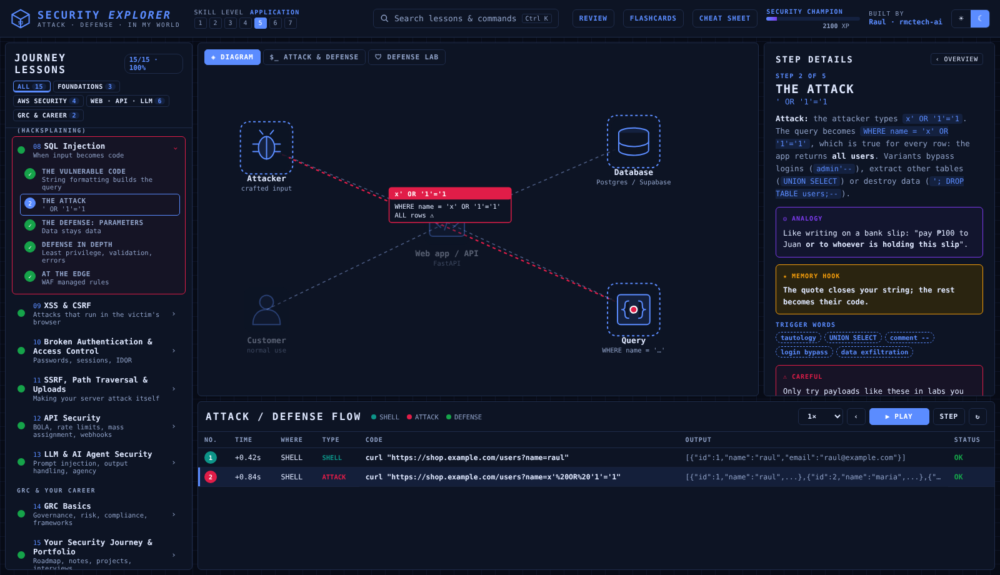

# 🧭 Security Journey Explorer — From Cloud Practitioner to cloud security, one attack and one defense at a time

An interactive, step-by-step security course that follows Raul's own roadmap after the CCP exam: **security foundations** (the CIA triad, how networks and Linux logs look to an attacker), **AWS security** (the Skill Builder IAM plan, the Security Champion path and a Secure AWS Account Baseline), **web, API and LLM security** (the Hacksplaining topics: injection, XSS, CSRF, broken access control, SSRF, API abuse and prompt injection) and **GRC basics**. Every lesson uses the same note format as the journey repo: **Attack** (what the attacker does), **Defense** (how you stop it) and **In my world** (what it looks like in AWS or in a FastAPI / Supabase / n8n / Claude stack), with analogies, memory hooks, trigger words, quizzes, and a **Defense Lab** where you write real Python to detect and block each attack.

> Created by **Raul** ([@rmctech-ai](https://github.com/rmctech-ai)) · Freelance AI Automation Specialist on the path to Cloud Security.
> Part of the Explorer series: [Linux Explorer](https://github.com/rmctech-ai/linux-explorer) · [Python Explorer](https://github.com/rmctech-ai/python-explorer) · [IAM Explorer](https://github.com/rmctech-ai/iam-explorer) · [VPC Explorer](https://github.com/rmctech-ai/vpc-explorer) · [IaC Explorer](https://github.com/rmctech-ai/iac-explorer) · [Serverless Explorer](https://github.com/rmctech-ai/serverless-explorer) · [CI/CD Explorer](https://github.com/rmctech-ai/cicd-explorer) · [Cloud Security Explorer](https://github.com/rmctech-ai/cloudsecurity-explorer).
> 🏠 Part of **[Raul's Cloud Learning Hub](https://rmctech-ai.github.io/)** · Live course: https://rmctech-ai.github.io/aws-security-journey/course/
> The Explorer course format is inspired by [Protocol Explorer](https://protocol-explorer-alpha.vercel.app/) by Dilum Sanjaya. All lessons, labs and study tools are my own work.



---

## ▶ Run it

No build step. Plain HTML/CSS/JS.

```bash
python3 -m http.server 8000     # then open http://localhost:8000
```

### Where it lives
This course is the `course/` folder of [aws-security-journey](https://github.com/rmctech-ai/aws-security-journey), published with the repo's GitHub Pages at **https://rmctech-ai.github.io/aws-security-journey/course/**. The tracker stays at the repo root.

---

## 🧭 How to use it

| Area | What it does |
|---|---|
| **Lessons** (left) | 15 lessons grouped by track. Click to expand steps. Dots show progress. |
| **Diagram** tab | Animated scene for every step. |
| **$_ ATTACK & DEFENSE** tab | Types out real commands/code for the step with realistic output. |
| **🛡 DEFENSE LAB** tab | **Defense Lab**: real Python (Pyodide) in the browser with realistic, fake security data: an nmap scan, an `auth.log` full of brute-force attempts, a dangerous IAM policy, an account baseline, a fake users database you can attack with SQL injection, malicious comments, private invoices, a support chatbot under prompt injection, and a risk register. Each challenge asks you to write the defender's code (parse, detect, escape, validate, hash, rate-limit, score), and a checker tests it against both normal and malicious input. |
| **Step Details** (right) | Explanation, **Analogy**, **Memory Hook**, **Trigger Words**, real-world notes, warnings. |
| **Attack / Defense Flow** (bottom) | Log of every command so far with type, output and status. |
| **XP & levels** | Earn XP for steps, lessons, quizzes and challenges. Saved in your browser. |
| **Cheat Sheet** | Master hooks + key syntax for every lesson (also [`CHEATSHEET.md`](CHEATSHEET.md)). |

**Keyboard:** `→` / `←` steps · `Space` play · `Ctrl+K` search · `Esc` close.

---

## 📚 Curriculum (15 lessons · 75 steps · 60 quiz questions · 15 hands-on challenges)

| # | Lesson | Track | You'll learn |
|---|---|---|---|
| 01 | The Security Mindset ⚑ | FOUNDATIONS | CIA triad, threats, risk, attack vs defense |
| 02 | Networks Through an Attacker's Eyes ⚑ | FOUNDATIONS | Ports, services, DNS, HTTP, scanning |
| 03 | Linux Logs for Defenders ⚑ | FOUNDATIONS | auth.log, brute force, sudo, journald |
| 04 | IAM Attacks & Defenses ⚑ | AWS SECURITY | Leaked keys, wildcards, PassRole escalation |
| 05 | Secure AWS Account Baseline ⚑ | AWS SECURITY | The 10 settings every account needs |
| 06 | Protect Networks & Data in AWS ⚑ | AWS SECURITY | Open SGs, public buckets, KMS, secrets |
| 07 | Detection & Incident Response ⚑ | AWS SECURITY | Triage findings, contain, investigate, recover |
| 08 | SQL Injection ⚑ | WEB · API · LLM | When input becomes code |
| 09 | XSS & CSRF ⚑ | WEB · API · LLM | Attacks that run in the victim's browser |
| 10 | Broken Authentication & Access Control ⚑ | WEB · API · LLM | Passwords, sessions, IDOR |
| 11 | SSRF, Path Traversal & Uploads ⚑ | WEB · API · LLM | Making your server attack itself |
| 12 | API Security ⚑ | WEB · API · LLM | BOLA, rate limits, mass assignment, webhooks |
| 13 | LLM & AI Agent Security ⚑ | WEB · API · LLM | Prompt injection, output handling, agency |
| 14 | GRC Basics ⚑ | GRC & CAREER | Governance, risk, compliance, frameworks |
| 15 | Your Security Journey & Portfolio ⚑ | GRC & CAREER | Roadmap, notes, projects, interviews |

⚑ = has a hands-on challenge.

## 🎯 Study plan & capstone

- **Week 1 (after the CCP exam):** Lessons 1–3 (foundations) alongside TryHackMe Pre Security, then lessons 4–7 alongside the Skill Builder IAM plan and Security Champion path.
- **Week 2:** Lessons 8–13 (web, API and LLM attacks) alongside the Hacksplaining lessons. Write one Attack / Defense / In my world note per lesson in `notes/`.
- **Week 3:** Lessons 14–15 (GRC and your portfolio), then build the Secure AWS Account Baseline project.

**Capstone:** In a free-tier account, apply the lesson 5 baseline (root MFA, no root keys, multi-Region CloudTrail, GuardDuty, Security Hub, IAM Access Analyzer, Block Public Access, a budget alert, default EBS encryption), capture before/after Security Hub scores, and publish the write-up in this repo.

## License
MIT © 2026 Raul (rmctech-ai)
